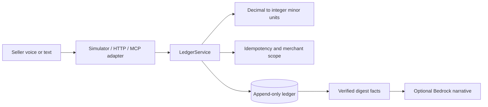

# BancaVoz

BancaVoz is a voice-first bookkeeping MVP for informal market sellers. A seller
can record sales, expenses, customer credit, payments, summaries, and reversals
through a FastAPI service, an MCP-compatible JSON-RPC surface, or the browser
simulator.

The design is deliberately safety-first: money enters the service as decimal
input and is stored as integer minor units; writes are idempotent; ledger rows
are append-only; and the deterministic simulator works without AWS credentials.

## Quick start

### PowerShell

```powershell
py -m venv .venv
.venv\Scripts\python -m pip install -e ".[dev]"
$env:BANCAVOZ_BEARER_TOKEN = "change-me"
uvicorn bancavoz.api:app --reload
```

### Bash

```bash
python3 -m venv .venv
. .venv/bin/activate
pip install -e '.[dev]'
export BANCAVOZ_BEARER_TOKEN='change-me'
uvicorn bancavoz.api:app --reload
```

Open `http://127.0.0.1:8000/sim` for the simulator or `/docs` for the OpenAPI
documentation.

## Architecture



The current repository is a local MVP. SQLite is supported for local/test use.
The checked-in PostgreSQL schema and SDK extra document the production direction,
but public deployment still requires validating a PostgreSQL adapter and the
official MCP Streamable HTTP transport.

## Authentication

`GET /healthz` is public. Other API routes require:

```text
Authorization: Bearer $BANCAVOZ_BEARER_TOKEN
```

The default development token is `dev-token`; replace it before deployment.

## Endpoints and tools

| Surface | Purpose |
| --- | --- |
| `GET /healthz` | Liveness check |
| `POST /sales` | Record a sale (`amount` or `unit_price` × `quantity`, optional `amount_paid`) |
| `POST /expenses` | Record an expense |
| `POST /credits` | Record credit |
| `POST /payments` | Record a payment |
| `POST /undo` | Reverse the latest live entry |
| `GET /summary` | Return ledger facts and a digest |
| `GET /stock` / `POST /stock` | Show or set stock levels; `?low_stock=true` filters alerts |
| `GET /top-sellers` | Rank items by quantity, optionally `?day=YYYY-MM-DD&timezone=...` |
| `POST /mcp` | JSON-RPC `tools/list` and `tools/call` smoke surface |
| `GET /sim` | Browser simulator with microphone fallback |
| `POST /sim/utterance` | Deterministic simulator command endpoint |

See [docs/MCP_TOOLS.md](docs/MCP_TOOLS.md), [docs/RUNBOOK.md](docs/RUNBOOK.md),
and [docs/GAPS.md](docs/GAPS.md) for the verified boundary.

## Testing

```bash
python -m pytest -q
python -m compileall -q bancavoz
```

The current tests cover money conversion, idempotency, merchant scoping, undo,
authentication, health, simulator handling, and MCP listing/call smoke behavior.
The full hackathon acceptance suite still requires live PostgreSQL, official MCP
client transport, external HTTPS smoke testing, and the complete six-utterance
script.

## Docker

```bash
docker compose up --build
```

The image runs the local SQLite MVP. Do not put real credentials in `.env` files
committed to Git; use the hosting provider's secret store.

## Project status

This is an honest hackathon MVP rather than a claim of verified production or
Alexa+ connectivity. See [docs/GAPS.md](docs/GAPS.md) for the requirement-by-
requirement status and [FRICTION_LOG.md](FRICTION_LOG.md) for observed issues.

## License

MIT. See [LICENSE](LICENSE).
