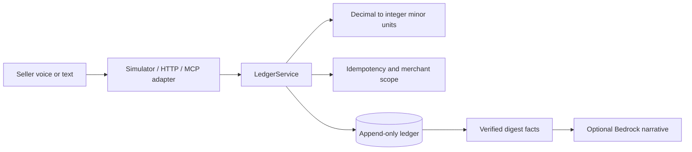

# BancaVoz

BancaVoz is a voice-first bookkeeping MVP for informal market sellers. A seller
can record sales, expenses, customer credit, payments, summaries, and reversals
through a FastAPI service, the official MCP Streamable HTTP surface, or the browser
simulator.

The design is deliberately safety-first: money enters the service as decimal
input and is stored as integer minor units; writes are idempotent; ledger rows
are append-only; and the deterministic simulator works without AWS credentials.

## Quick start

### PowerShell

```powershell
py -3.12 -m venv .venv
.venv\Scripts\python -m pip install -e ".[dev]"
$env:BANCAVOZ_BEARER_TOKEN = "change-me"
uvicorn bancavoz.api:app --reload
```

### Bash

```bash
python3.12 -m venv .venv
. .venv/bin/activate
pip install -e '.[dev]'
export BANCAVOZ_BEARER_TOKEN='change-me'
uvicorn bancavoz.api:app --reload
```

Open `http://127.0.0.1:8000/` for the landing page, `/app` for the merchant
console, `/sim` for the simulator, or `/docs` for the OpenAPI documentation.

The frontend is deliberately dependency-free: semantic HTML, local CSS, and
ES-module JavaScript are served from `bancavoz/web`. Console authentication is
token-in-memory only. The console reads summary, stock, credits, and entries,
and sends authenticated commands through the API.

## Architecture



SQLite is supported for local/test use and PostgreSQL is the production backend.
The pinned official MCP SDK is mounted at `/mcp` and `/mcp/`. The repository
includes `render.yaml` for a managed PostgreSQL deployment.

## Authentication

`GET /healthz` is public. Other API routes require:

```text
Authorization: Bearer $BANCAVOZ_BEARER_TOKEN
```

The default development token is `dev-token`; production refuses to start with
that value. Production startup applies the schema, creates the configured
merchant token hash, and exposes `/readyz` only after the database is reachable.

## Endpoints and tools

| Surface | Purpose |
| --- | --- |
| `GET /healthz` | Liveness check |
| `POST /sales` | Record a sale (`unit_price` × `quantity`, optional `amount_paid`) |
| `POST /expenses` | Record an expense |
| `POST /credits` | Record credit |
| `POST /payments` | Record a payment |
| `POST /undo` | Reverse the latest live entry |
| `GET /summary` | Return ledger facts and a digest |
| `GET /entries` | List recent authenticated ledger entries |
| `GET /credits` | Return authenticated customer credit balances |
| `POST /command` | Parse and execute an authenticated text command |
| `GET /stock` / `POST /stock` | Show or set stock levels; `?low_stock=true` filters alerts |
| `GET /top-sellers` | Rank items by quantity, optionally `?day=YYYY-MM-DD&timezone=...` |
| `POST /mcp` and `POST /mcp/` | Official MCP SDK Streamable HTTP tools |
| `GET /sim` | Browser simulator with microphone fallback |
| `POST /sim/utterance` | Deterministic simulator command endpoint |

See [docs/MCP_TOOLS.md](docs/MCP_TOOLS.md), [docs/RUNBOOK.md](docs/RUNBOOK.md),
and [docs/GAPS.md](docs/GAPS.md) for the verified boundary.

## Testing

```bash
python -m pytest -q
python -m compileall -q bancavoz
```

Latest local run: `python -m pytest -q` → `31 passed`.
The tests cover money conversion, idempotency conflicts, merchant scoping, undo,
authentication, health, simulator handling, isolated factories, both MCP paths
with the official client, and deployment configuration contracts. Live
PostgreSQL and external HTTPS smoke testing remain unverified.

## Docker

```bash
docker compose up --build
```

The compose file includes a health-checked PostgreSQL service and the image runs
`bancavoz-migrate` before Uvicorn. Do not put real credentials in `.env` files
committed to Git; use the hosting provider's secret store.

## Production deployment

Render is the supported deployment path:

```bash
render blueprint launch
```

Set a strong random `BANCAVOZ_BEARER_TOKEN`, then verify:

```bash
curl -fsS https://<service>.onrender.com/healthz
curl -fsS https://<service>.onrender.com/readyz
curl -fsS -H "Authorization: Bearer $BANCAVOZ_BEARER_TOKEN" \
  https://<service>.onrender.com/summary
```

Record the actual URL and raw command output in `docs/RUNBOOK.md`.

## Live URL

Live URL: not deployed.

## Screenshots

Add verified screenshots of `/`, `/app`, `/sim`, and the MCP tools panel here
after a hosted deployment or a local capture run.

## Project status

This is an honest hackathon MVP rather than a claim of verified production or
Alexa+ connectivity. See [docs/GAPS.md](docs/GAPS.md) for the requirement-by-
requirement status and [FRICTION_LOG.md](FRICTION_LOG.md) for observed issues.

## License

MIT. See [LICENSE](LICENSE).
