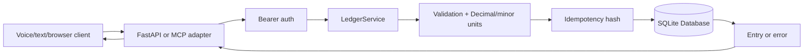
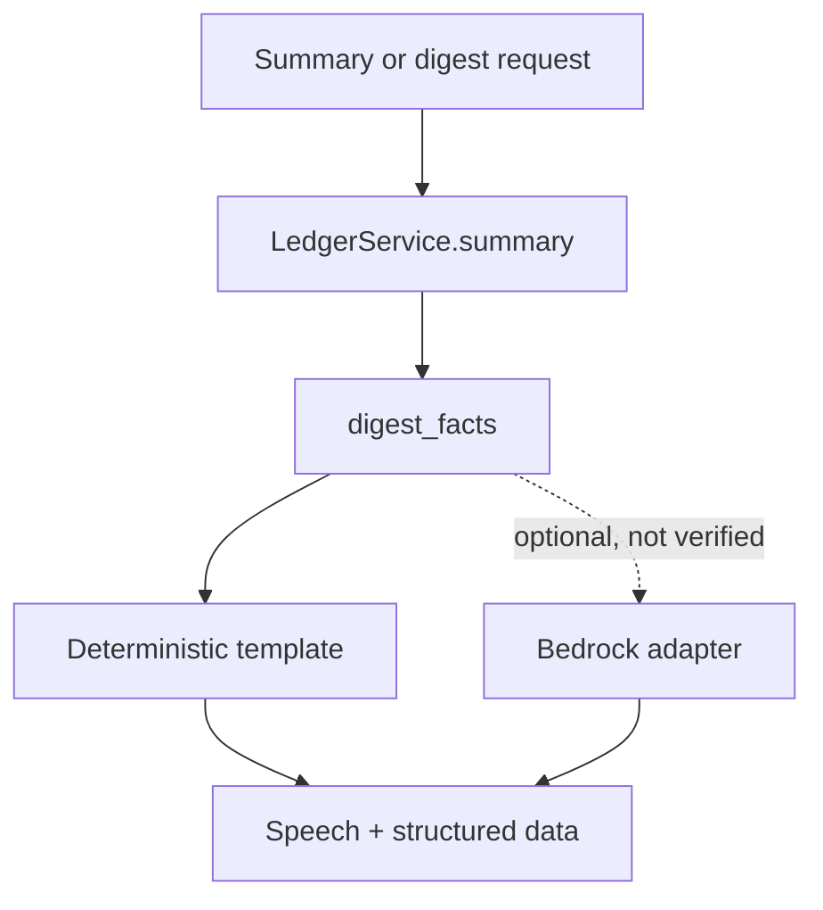

# Architecture

## Layers

- **Adapters:** FastAPI routes, static web pages, simulator JSON endpoint, and
  official MCP Streamable HTTP.
- **Application/service:** `LedgerService` validates inputs, normalizes names,
  converts money to integer minor units, enforces idempotency, and appends
  reversals.
- **Persistence:** `Database` owns the SQLite connection, schema bootstrap,
  transactions, and stock tables. PostgreSQL is not currently supported.
- **Presentation:** `speech.py` formats short spoken responses; `digest.py`
  converts verified summary facts into a deterministic template. Bedrock
  narration is optional code, not a verified deployed path.

## Request flow

## Digest flow

Facts are calculated by the service; narration must not calculate accounting
totals. Current verified behavior uses the deterministic template for
`GET /summary`.
